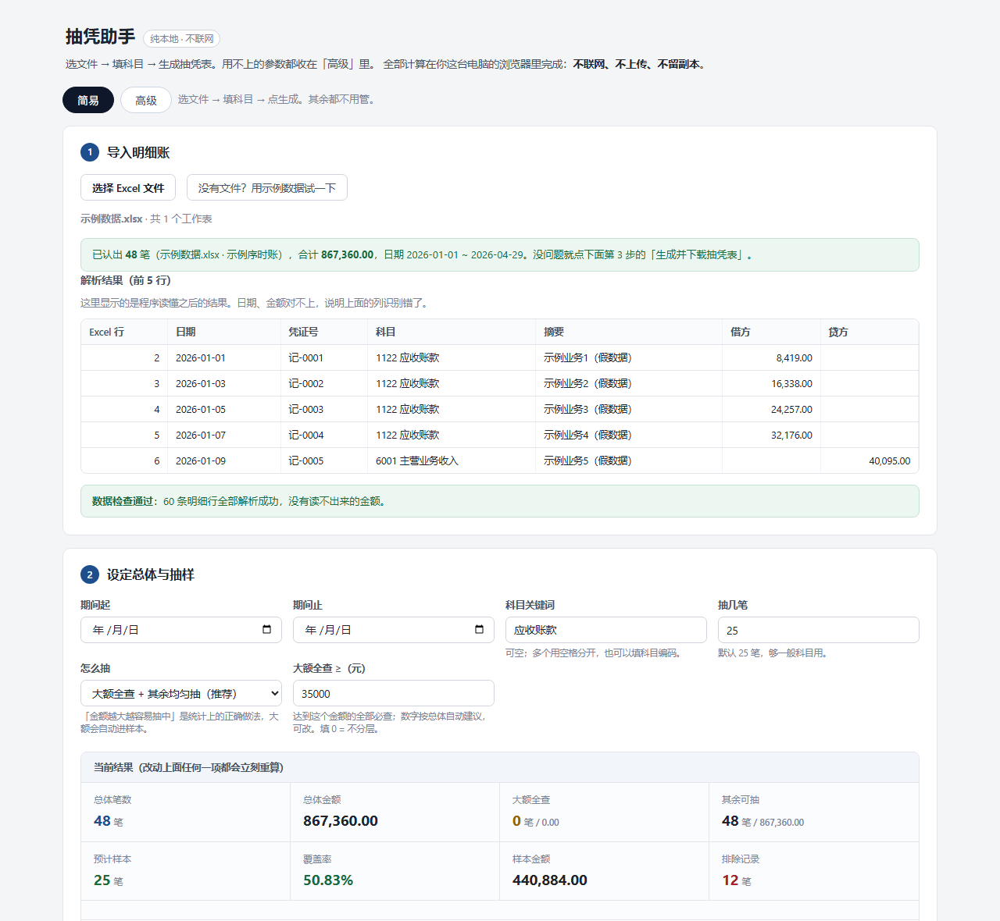

# 抽凭助手 v0.6

给审计实习用的本地抽凭工具。**双击 `index.html` 就能用**（Chrome / Edge），不用装 Python、不用联网。

> 仓库：<https://github.com/Lee2277-t/vouching-sampler>
> 直接下载：<https://github.com/Lee2277-t/vouching-sampler/releases/latest>
> 想改代码就 `git clone` 本仓库，跑一遍测试：`powershell -File test\run-all.ps1`（需要 node 与 python）

## 60 秒上手

1. 双击 `index.html`
2. 点「没有文件？用示例数据试一下」——不用等客户给数据，先跑通一遍
3. 看到 `已认出 48 笔…` 就点「生成并下载抽凭表」
4. 打开下载的文件，看五页里是不是你想要的东西
5. 换成自己的文件，重复 2-4

出问题先看页面上的红字提示，那不是报错，是它在告诉你它读到了什么。

## 先看这个：默认只有四项

打开就是**简易模式**，屏幕上只有：

```
① 选文件（或点「用示例数据试一下」）
② 科目关键词（可空，如 应收账款）
③ 期间（可空 = 全部）
④ 抽几笔（默认 25）
   → 点「生成并下载抽凭表」
```

认出数据后会出一句话：`已认出 419 笔（序时账.xlsx · 序时账），合计 5,700,003,029.94，日期 2026-01-01 ~ 2026-06-30`。
对得上就点生成，对不上再切右上角「**高级**」。

高级里才是：主体、方向、金额上下限、全查阈值、抽样单元、抽样方法、种子、证据列方案、表头行、列识别、表的走向、索引号、编制人、复核人。

**没有文件也能先跑一遍**：点「用示例数据试一下」，会生成 60 笔假账（48 笔应收账款 + 12 笔收入），走完全相同的识别与抽样路径，可以用来教人。

## 完整流程（四步）

1. **导入**：选客户系统导出的明细账 / 序时账（xlsx、xls、csv 都行）。**可以一次选多个文件**（如按月导出的 12 份），也可以在一个工作簿里按住 Ctrl 多选几张表 —— 都会合并成一个总体
2. **设定**：简易模式只要科目、期间、样本量；要分层、按凭证抽、按主体筛，切「高级」
3. **生成**：下载五页的 xlsx —— 抽凭表 / 抽样信息 / 排除清单 / 数据检查 / 说明
4. **回录**：现场核对完，在抽凭表填「核对结论」和「错报金额」，再把这份文件选到第 4 步，算出例外、**错报上限**与**判断抽样的推断错报**，并可导出评估表 xlsx

界面上每改一个条件，总体笔数、分层、预计样本、覆盖率会立刻重算。

## 怎么抽：三种口径，别用错

| 选项 | 意思 | 什么时候用 |
|---|---|---|
| **大额全查 + 其余均匀抽**（默认） | 金额 ≥ 阈值的一笔不漏，剩下的按行序等距抽 n 笔 | 实质性程序取样本，最常用。阈值按「总体金额 ÷ 抽几笔」自动建议，可改 |
| **按金额加权（PPS）** | 把总体当成一条金额轴，等距取点，落到哪笔抽哪笔 | 想要统计推断（MUS 上限）时用。金额越大被抽中概率越高，单笔 ≥ 间隔的**必然**被抽中 |
| **纯随机** | 每笔机会相同 | 控制测试、均匀覆盖，或只想看看样本长什么样 |

关键区别：**前两种都会把大额拉进样本**，第三种不会。
默认是第一种——因为「抽凭」绝大多数时候就是为了看大额那一笔靠不靠谱。

金额加权有个必须知道的现象：一笔特别大的记录会横跨多个金额间隔，被命中多次，
所以**实抽笔数会少于你填的「抽几笔」**。这是正常结果，抽样信息页会写明「不是漏抽」。

**错报上限只对第三种（按金额加权）成立。** 等距/分层样本里每笔被抽中的概率不相等，
套 Stringer 公式算出来的数没有意义，所以程序**不给你算**，并说明为什么。
真需要上限，就改用按金额加权重新抽一份。

## 已知限制（会被程序明确拒绝，而不是悄悄算错）

- 欧式小数写法（`1.234,56` 表示 1234.56）识别不了，会读成 1.23 —— 见到可疑小数请改列
- 竖排表转置后，若数据不从 A 列开始，「原始列号」会整体偏移
- 加密的 xlsx 读不了，会提示换一份
- 「核对结论」只能填标准的几种说法；写成长句会报「认不出」而不是猜
- 金额/阈值只认阿拉伯数字，写「10万」会被拦下并要求改成 100000

## 第 4 步到底在干什么

第 3 步生成了 `抽凭表.xlsx`，你打印出来去翻凭证，在**最后两列**填「核对结论」和「错报金额」。
填完，**把这一份文件原样选进第 4 步**——不是复制、不是另存、不是加上传，就是同一份 xlsx。

程序读的是你填的那两列，然后算：几笔相符、几笔不符、错报多少、统计上总体可能错多少（错报上限）。

为什么非要走这一圈：抽样的价值在**评价**，而评价必须基于现场结果。工具没法预知你翻到的东西，
所以只能等你填完再读一次。这也是为什么第 4 步可以完全不碰——不填结论，它就只报「尚未填写」。

## 五条红线（改代码前先读）

1. **金额一律按「分」整数**存储与运算，展示才除 100。禁止浮点累加。
2. **不静默丢行**：任何没进总体的记录，都要落在「排除清单」里并附原始 Excel 行号。
3. **抽样可复现**：同数据 + 同参数 + 同种子 → 同一批样本；种子、起点、间距写进输出文件，别人照着重跑能对上。
4. **不代替判断**：勾稽列空白等手勾；错报上界只是统计推断值，能不能接受由审计人员判断并签字。
5. **保守且说清楚**：「未取得」按 100% 错报计入上限；上限按总体账面封顶 —— 两件事都写在评估表里，不许悄悄做。

## 一条命令跑全部回归

```powershell
powershell -NoProfile -ExecutionPolicy Bypass -File test\run-all.ps1
```

需要 node 和 python。脚本会用 Python 重新生成夹具与期望值，再跑 8 个套件：

| 套件 | 断言 | 验什么 |
|---|---|---|
| `core.test.js` | 110 | 金额、日期、认列、总体过滤、抽样、输出结构 |
| `export.test.js` | 31 | 写成 xlsx 字节再读回，逐笔核对金额与格式 |
| `real.test.js` | 23 | 两份公开序时账的回归 |
| `formats.test.js` | 37 | 四种真实导出格式（金蝶 / SAP / 制单凭证 / 科目余额表） |
| `limits.test.js` | 157 | 已知限制 + 独立审核发现的每条问题（结论词 / 凭证撞号 / 方向 / 错报读不出 / 汇总行） |
| `eval.test.js` | 82 | 泊松系数对 AICPA 表、Stringer 上限、回录闭环、评估表导出、MUS 适用性拦截 |
| `wiring.test.js` | 90 | id 接线、Core 方法对齐、简易/高级切换、**页面无任何外链** |
| `ui-smoke.test.js` | 69 | 假 DOM 真跑 app.js：多表/多文件/竖排 → 生成 → 回录 → 导出；含简易模式、金额加权、非法输入拦截 |

合计 **599 项断言**。

`wiring` 是静态检查，只能证明 id 和方法名对得上；`ui-smoke` 是动态的，会把 `app.js` 原样
require 进来，喂一份 xlsx 走完整个流程 —— 「刷新时有个字段名写错了」这类 bug 只有它能抓到。
它上线第一天就抓到一个：假 `FileReader` 少写了 `result` 属性，页面拿到空数组还以为读成功了。

期望值都不是手抄的：合成夹具的期望值由 Python 用 `Decimal` 独立算（`make_fixture.py`），
真实样例的期望值由 openpyxl 独立扫（`make_real_truth.py`）。JS 侧和 Python 侧是两条独立路径。

## 真实数据回归

`test/fixture/` 里的两份序时账来自公开仓库（**不是客户数据**）：

- [aging-generator](https://github.com/Cathywang1988/aging-generator) —— 只有科目、**没有凭证号列**
- [valuation-detail-table](https://github.com/zer0-lyz/valuation-detail-table) —— 凭证号拆成**「字」+「号」两列**，且科目编码与科目全路径同时存在

它们打回过三个真缺陷，留着防复发：

| 现象 | 后果 | 修法 |
|---|---|---|
| 科目认成「原科目编码」 | 按「应收账款」筛，一笔都筛不出来 | 科目与科目编码分成两个字段 |
| 「字」+「号」分两列 | 凭证号全空，现场没法翻 | 自动拼成「记账凭证-1」 |
| 「期初余额」行借贷为空 | 当成零金额交易混进排除清单 | 单列为「无金额行」并跳过 |

## 真实底稿打回的另外三个问题

用实际工作底稿（不外传，只在本机诊断）跑了一遍，又发现三类：

| 现象 | 后果 | 修法 |
|---|---|---|
| 工作簿里「科目余额表」排在「序时账」前面 | 默认选中余额表，抽出 68 笔**没有期间的假样本** | 逐表判定可用性，自动选真正的明细账 |
| 日期列叫「制单日期」 | 1147 笔全被判「日期缺失」 | 补别名：制单/填制/制证日期 |
| 同一张凭证被抽中多行 | 现场要重复翻同一本凭证 | 单独统计「涉及凭证数」，提示只需翻几次 |

**判定不可用的表会直接拒绝生成**，只给一条说明：科目余额表、报表有借贷金额但没有日期，硬抽出来的是没有期间的假样本 —— 宁可不给，也不能给错。

规模上，实测最大的一份序时账 11,487 行 / 8.8 MB，全流程 3.8 秒（含读文件）。

拿不准某张表能不能用时，先跑诊断：

```powershell
node test\probe.js 你的文件.xlsx
```

它会打印：表头认在第几行、每个字段认到了哪一列、解析出几条明细、哪几列没认出来。

## 错报上限怎么算

按 Stringer 方法（AICPA 审计抽样指南的货币单元抽样口径）：

```
上限 = (总体账面金额 / 实际检查的样本量) × [ R0 + Σ tⱼ × (Rⱼ − Rⱼ₋₁) ]
```

- `tⱼ` 是第 j 笔错报占该笔账面的比例，降序排列，超过 100% 按 100%
- `Rⱼ` 是 j 笔错报时的泊松上界系数：95% 置信下 R0=3.00、R1=4.75、R2=6.30、R3=7.76、R4=9.16
- 系数由程序用二分法解 `P(X≤j; λ)=α` 算出，测试里与公布值逐项比对（误差 < 0.02）

`test/fixture/example_evaluation.xlsx` 是一份评估表的样子。

## 目录

```
index.html                 界面
app.js                     读文件 / 表单 / 下载 / 评估
core.js                    纯逻辑（node 可直接 require）
app.css                    样式（无外链、无在线字体）
vendor/xlsx.full.min.js    SheetJS，本地化
samples/                   下载的真实样例（可重新下载）
test/run-all.ps1           一键全量回归
test/probe.js              单份文件的诊断（默认只报结构，不打印明细）
test/*.test.js             8 个套件
test/*.py                  生成夹具与期望值
test/fixture/              夹具 + 期望值 + 示例产出
```

`probe.js` 默认**只打结构不打明细**：真实底稿里有客户名和摘要，诊断时不需要把它们印到屏幕上。
要看前 5 条再加 `--show`。

## 曾经的限制，逐条解决

| 原来 | 现在 | 断言在 |
|---|---|---|
| 一次只处理一张工作表 | 按住 Ctrl 多选，每张各自认表头后合并；不可用的表自动跳过并说明 | `ui-smoke` §3 |
| 一次只处理一个文件 | 文件框可多选，每个文件每张表独立认表头，再合并成一个总体 | `ui-smoke` §6 |
| 一个科目区间 | 关键词用空格/逗号/顿号分隔，命中任一即可，也可以混科目编码 | `limits` §1 |
| 多主体账表不分主体 | 认「公司代码描述／主体名称／公司名称」，下拉筛选 | `limits` §2 |
| 只认单行表头 | 两级合并表头两行拼接（「本期发生额」+「借方金额」） | `limits` §4 |
| 抽样单元只有明细行 | 可选「按凭证」：同一张凭证合并为一笔 | `limits` §3 |
| 判断抽样无推断 | 比率法 + 差异法两种推断错报都算出来 | `limits` §5 |
| 英文表头认不出 | 中英别名混排：`Posting Date`／`Document Number`／`G/L Account` 都认 | `limits` §7 |
| 只认一行一条明细的横表 | 竖排表自动转置；转置后「原始行号」改称「原始列号」 | `limits` §8 |
| 冷门 ERP 私有字段名 | 手工指定一次就记住，下次同样的写法自动认 | `limits` §9 |
| 结论写法认不出 | 扩充词表，且按最长命中匹配（「不符合」不会被「符合」抢走） | `limits` §6 |

四条容易踩的坑，都在测试里留了名字：

1. **借贷平衡的凭证净额是 0** —— 按凭证抽样时如果拿净额当凭证金额，整批凭证会被归进
   「金额为零」全部排除。所以凭证金额取借/贷发生额较大的一方：`借贷平衡的凭证不塌成 0`。
2. **`G/L Account` 与 `Account Number`** —— `norm` 去掉斜杠后是 `glaccount` 和 `accountnumber`，
   前者进「科目」、后者进「科目编码」。混了的话用户按科目筛会一笔都筛不出来：`Account Number → 科目编码，不能和科目抢`。
3. **`不符合` 不能被 `符合` 抢走** —— 词表匹配改成最长命中。`已取得` 之类证据描述不判成相符，
   报「认不出」让人确认：`长句不猜，报 other 让人看`。
4. **竖排表的位置不是行号** —— 转置后一个样本的「原始位置」其实是原表的**列**。
   抽凭表把这一列改名为「原始列号」并在说明页注明，不能让人拿着列号去数行：
   `竖排表不应把列位置说成「原始行号」`。

## 记住列名这件事

冷门 ERP 的私有字段名（`SZRQ`、`JFJE` 这种）不可能穷举。做法是：你在「列识别」里手工指一次，
程序把**表头文字**记下来，下次遇到同样的写法自动认。存在本机 `localStorage`，键名
`chouping.learned.v1`，面板上有「忘掉记住的列名」。

只存表头文字，不存金额、摘要、客户名；`localStorage` 在部分浏览器的 `file://` 下会被禁，
存取全包在 `try` 里，存不了不影响主流程。

## 还剩的限制

- **只认「一行一条明细」或「一列一条明细」**。科目在行、月份在列的矩阵表（余额表、趋势表）
  转置后仍然没有凭证号，抽不了 —— 那本来也不是抽凭的输入。
- 列识别以中英常见别名为准；从未见过的写法要手工指一次（指过就记住了）。
- 不做账龄、明细表勾稽、函证 —— 那是另外三个工具。
- 「核对结论」写成长句（如「已取得发票」）会报「认不出」而不是硬猜，需要人改成标准说法。
- 跨文件合并时假设各文件列口径一致；不一致也能读（各自认表头），但**不会提醒你两个文件的
  同一科目可能是不同口径**，这属于职业判断。

## 数据安全

全部计算在浏览器本地完成，没有网络请求、没有埋点、没有外部字体。
`wiring.test.js` 会检查页面里不存在任何 `http(s)` 外链、`fetch`、`XMLHttpRequest`，这条是自动守着的。




**不想下载？** [在线试用](https://lee2277-t.github.io/awesome-lee2277/tools/vouching/)（同一份代码，纯前端，文件只在浏览器里读）

**不想读文档？** [下载最新版 ZIP](../../releases/latest) → 解压 → 双击 index.html，就这样。仓库里也有 index.html，直接打开同样是完整功能。

---

更多离线小工具（审计、文档、系统）见 [awesome-lee2277](https://github.com/Lee2277-t/awesome-lee2277)。
